# Hi, I'm Kaisar Hameed 👋

### React Native (Expo) developer · Building mobile products end to end

### <code>kaisar@github ~ $ ./contributions</code>

### <code>kaisar@github ~ $ whoami</code>

I build and ship production React Native apps — from architecture to App Store and Play Store release. I recently shipped [Nikahfyme](https://nikahfyme.com), a matrimony app for the Muslim community, and maintain an open-source onboarding and tour library for React Native.

---

### 🚀 Recent Work

- **[Nikahfyme](https://nikahfyme.com)** — Muslim matrimony app · [App Store](https://apps.apple.com/in/app/nikahfyme/id6745527703?ref=website) · [Google Play](https://play.google.com/store/apps/details?id=com.nikahfyme.app&ref=website)
- **[KashmirCalls](https://kashmircalls.com)** — web platform
- **[MiyaTravel](https://miyatravel.com)** — travel booking platform
- **[react-native-tour-guide](https://github.com/kaisarsofi/react-native-tour-guide)** — open-source spotlight and walkthrough tour library for React Native apps

### 🌱 Currently

Focused on React Native + Expo, polished mobile UX, native module integration, and open-source tooling for developer onboarding flows.

All projects: **[kaisarsofi.github.io](https://kaisarsofi.github.io/)** · 📫 [kaisersofi.ks2515@gmail.com](mailto:kaisersofi.ks2515@gmail.com)

---

### 🌐 Connect

### 🛠️ Core Stack

**Mobile**
   

**Frontend**
    

**Backend**
     

**Tools**
   

---

### 📊 GitHub Stats

  
  

  
   
  

<!-- Contribution heatmap generated from GitHub's public contribution calendar. -->
